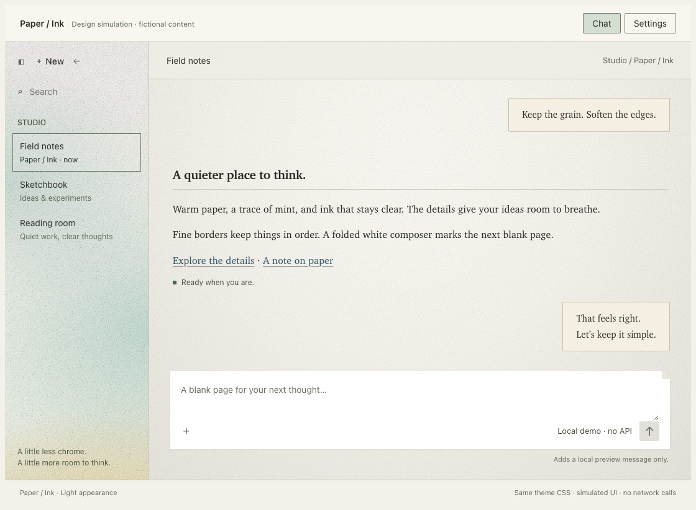
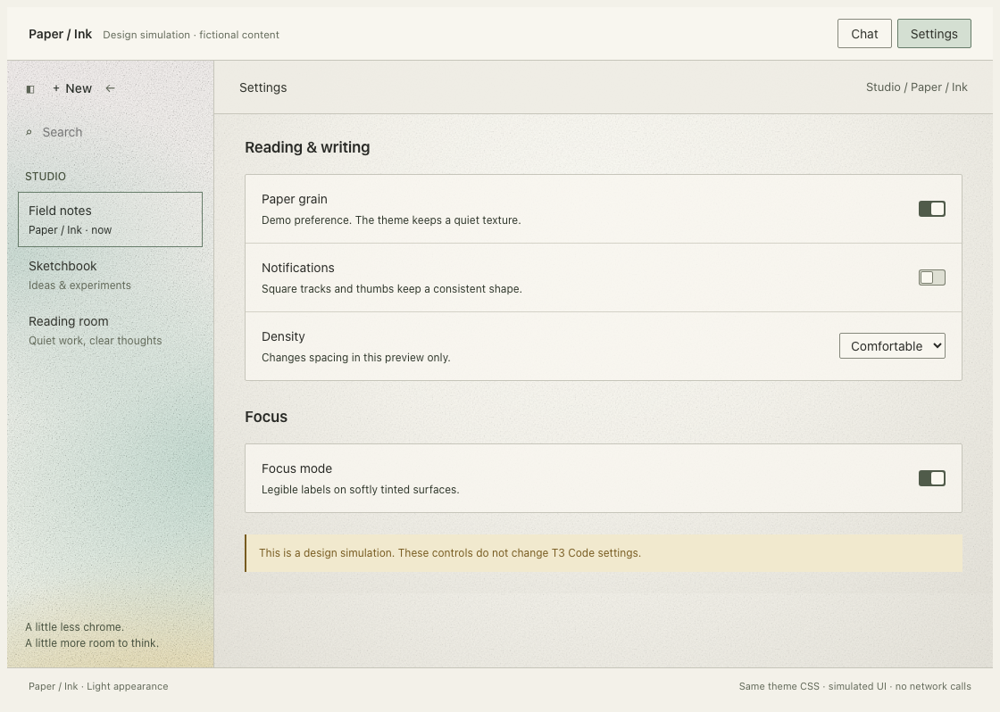

# Paper / Ink

A T3 Code theme with warm paper surfaces, soft mint grain, and ink-colored text.
Fine borders, square controls, and a folded white composer give the interface a quiet, tactile feel.



## Install

1. Download [paper-ink.json](paper-ink.json) from this repository.
2. In T3 Code, open **Settings → Appearance**, then **Add a theme** or the theme import dialog.
3. Drop in the JSON file or paste its contents, then select **Paper / Ink**.
4. Use **Light** appearance.

Requires a recent T3 Code web or desktop build with Custom CSS support.
Initially checked against **0.1.10-nightly.20261114.4709**. Mobile and dark appearance are not supported.
No server installation changes or application fork are required.

Import the JSON's `css` along with its colors to apply the grain, folded composer, and control shapes.
Palette-only VS Code theme converters and some external galleries cannot reproduce the complete design.

## Preview

Download [preview.html](preview.html) and open it in a browser to explore the Chat and Settings screens.
Typing, adding demo messages, and toggling controls happen locally. No account or API connection is involved.

The interactive preview and images are **design simulations** with fictional conversations and projects.
They use the same CSS as the distributed theme, but do not reproduce the full T3 Code application.
Check compatibility in the actual app after T3 Code updates.



## Restore the default theme

Choose a built-in theme in **Settings → Appearance** or the theme picker.
If the interface is difficult to use, run this command on the machine hosting your T3 Code server:

```sh
t3 theme set t3-chat
```

This also switches the theme for web and desktop clients connected to that server.

## Customize and validate

Requires Python 3.9 or later, with no additional packages.

```sh
python3 scripts/theme.py build
python3 scripts/theme.py check
```

Edit these source files:

| File | Purpose |
| --- | --- |
| [src/theme.json](src/theme.json) | Metadata and color palette |
| [src/paper-ink.css](src/paper-ink.css) | Shapes, layout, and background textures |
| [src/preview.html](src/preview.html) | Demo content and preview interface |

The root `paper-ink.json` and `preview.html` are generated files. Rebuild them after editing the sources.
The script checks the CSS length limit, external resource references, generated file consistency, and contrast for key text color pairs.
These checks do not cover the actual rendering of grain, gradients, transparency, hover states, or keyboard focus.

## Check compatibility

After an update, check chat links, file links, message bubbles, send and stop buttons, both switch states,
Usage tab selection, and dropdowns in the actual app. Use Tab to check keyboard focus indicators.
The CSS uses `data-slot`, `data-*`, and ARIA attributes where possible, but changes to the app's structure can still affect it.
The serif font stack uses installed system fonts, so typography can vary between devices.

## Release

Attach `paper-ink.json` to a GitHub Release after running `check`.
Refresh the demo images when the CSS or interface changes, and record the tested T3 Code version in the release notes.
Users only need the JSON file to install the theme.

## License

[MIT](LICENSE). An unofficial community theme, not affiliated with T3 Tools.
[T3 Clawd](https://github.com/rohit3a/t3-clawd) served as a reference for distributing a theme as a standalone JSON file.
The theme implementation comes from this repository's Paper / Ink sources.
